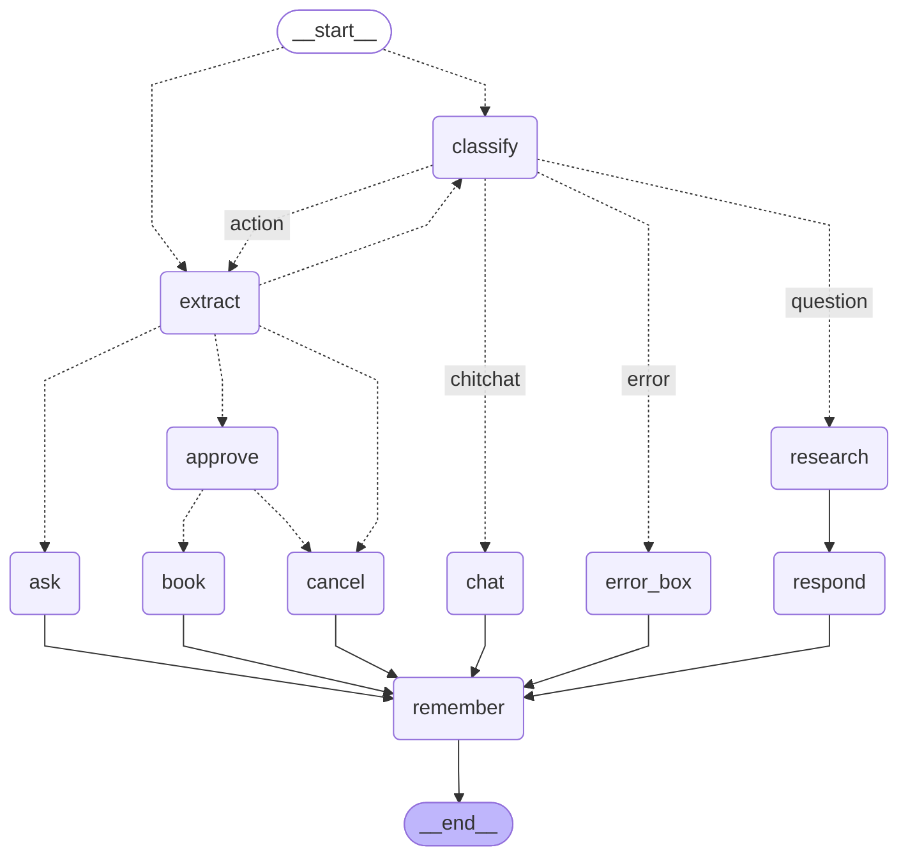

# Week 15 - Vocview as a LangGraph state machine

Diagram generated from `sat_build/vocbook.py` by `draw_vocbook.py`. Do not hand-edit.

Dotted arrow = router decides. Solid arrow = always taken.
`approve` pauses with `interrupt()` and waits for an exact "yes". The diagram cannot show the pause.

## sat_build files

- Run: `python askbook.py <thread> "<message>"` (graph wired in `vocbook.py`)
- Sweeps, Saturday's measurement record: `peek.py`, `answer_sweep.py`, `ans_prompts.py`, `ans_sweep.py`, `ans_confirm.py`, `e2e_tools.py`, `par_prompts.py`, `par_tools.py`, `par_sweep.py`, `cancel_sweep.py`
- STALE, written before Saturday's fixes, do not re-run: `agent_prompts.py`, `agent_shape.py`, `e2e_prompts.py`, `e2e_sweep.py`, `cancel_cases.py`
